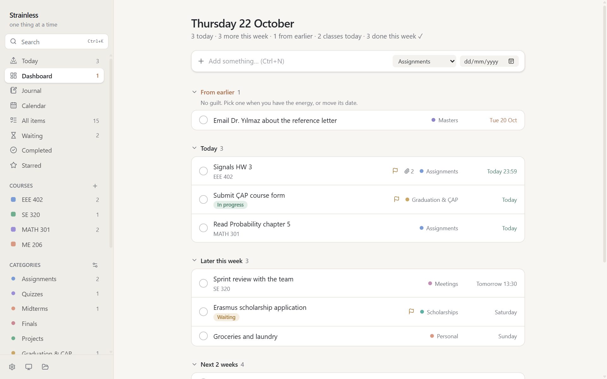
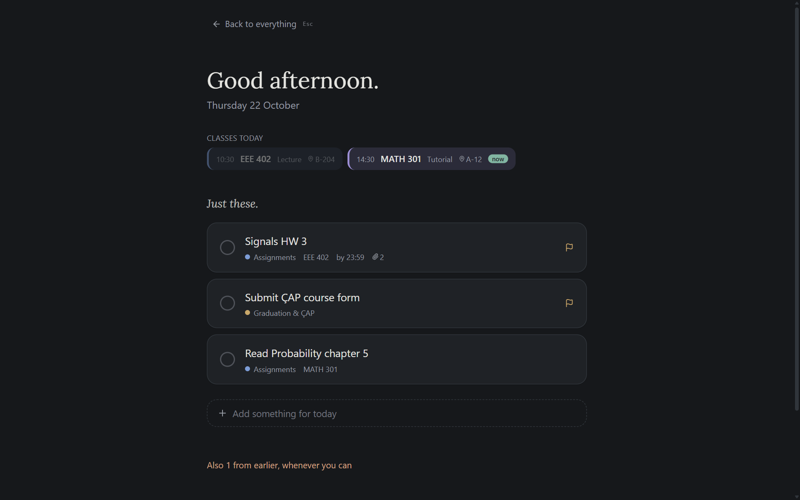
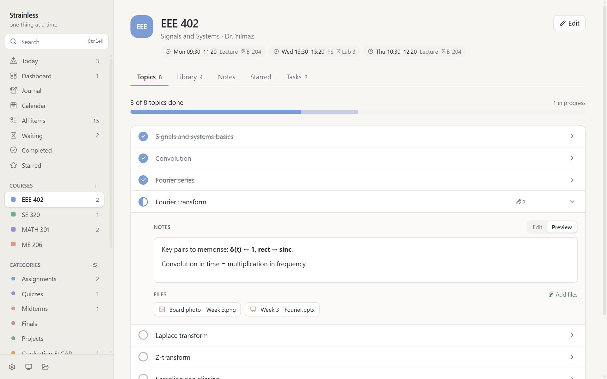
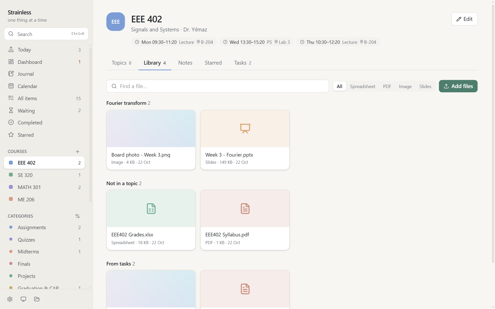
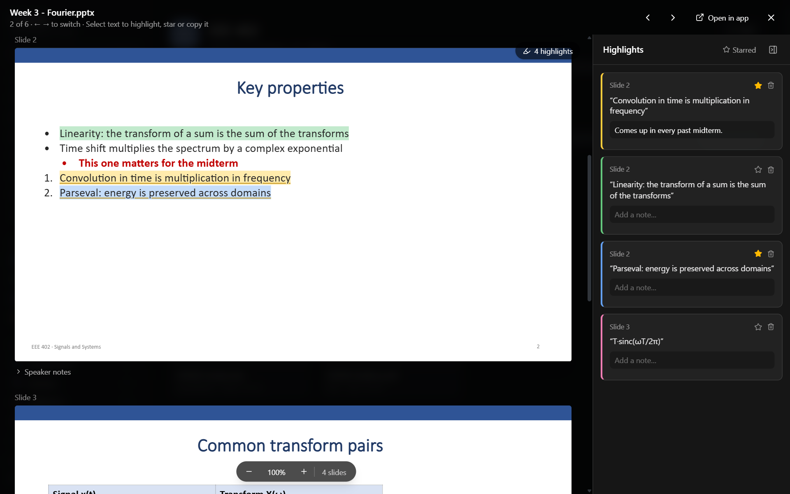
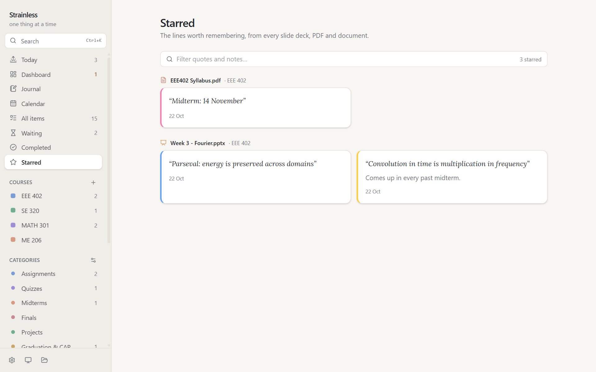
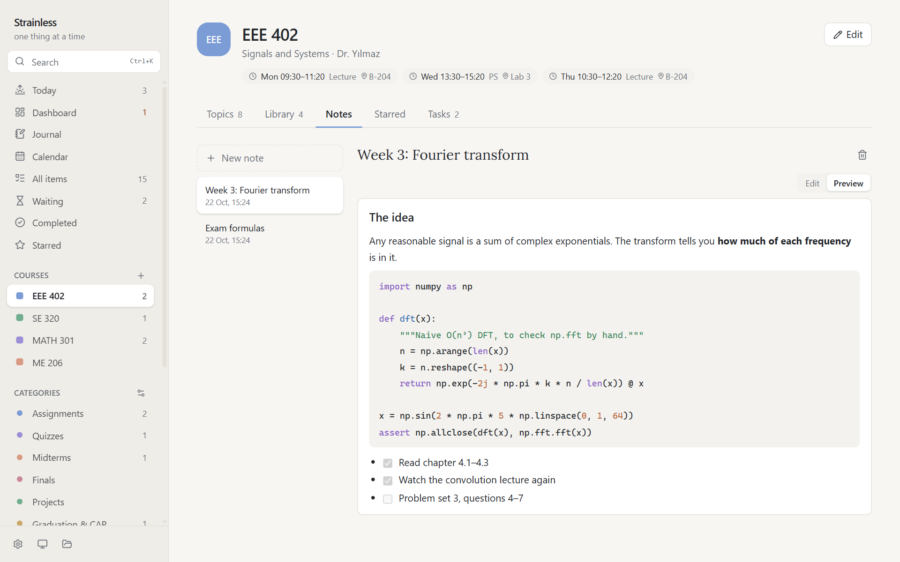
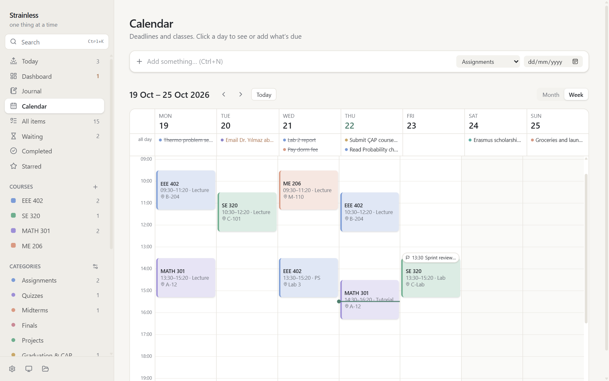
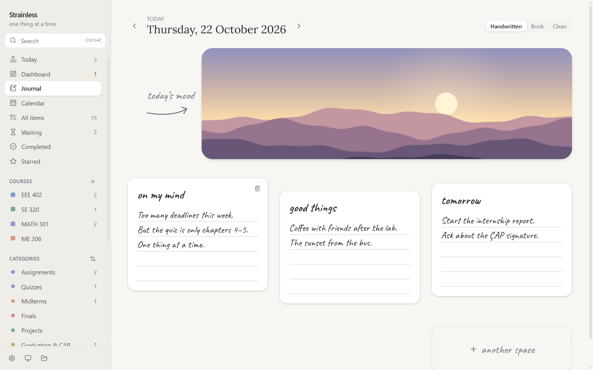
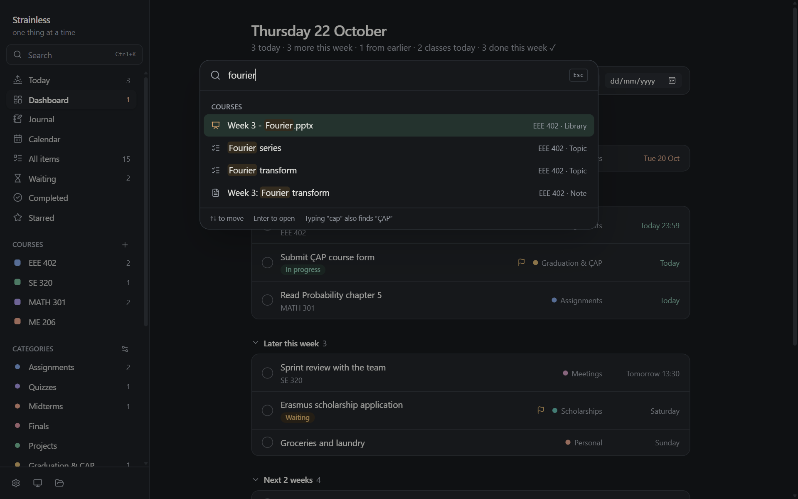

# Strainless

A desktop app for keeping a university semester under control: deadlines, courses,
lecture slides, notes and a small daily journal, all in one place and all stored on
your own computer. Runs on Windows and macOS.



## What it does

**Today and the dashboard.** The dashboard sorts everything by when it's due: from
earlier, today, later this week, the next two weeks, later, and no date. Weeks are
calendar weeks (Monday to Sunday). Today mode hides everything else and shows the
day's classes and the first three tasks.



**Courses.** Each course has a weekly timetable, semester dates and five tabs:

- Topics: the syllabus as a checklist with a progress bar. Paste a list and every line becomes a topic.
- Library: every file for the course (slides, PDFs, Word, Excel, images, code), grouped by topic. Drag files in from Explorer or Finder.
- Notes: markdown pages with syntax-highlighted code blocks. Screenshots can be pasted straight in.
- Starred: the quotes you starred in this course's files.
- Tasks: homework, quizzes and exams for the course.





**Reading and highlighting.** PDF, Word (.docx), PowerPoint (.pptx) and spreadsheets
(.xlsx, .xls, .ods, .csv) open inside the app. Select text to highlight it in one of
four colours, star it, or copy it. Highlights are saved and come back when you reopen
the file, with a side panel for notes.





**Notes with code.**



**Calendar.** Month and week views. The week view shows classes as blocks next to deadlines.



**Journal.** One page per day, with a photo for the day's mood and free-write spaces in a
handwritten, book or plain font.



**Search.** `Ctrl+K` (`⌘K` on a Mac) searches tasks, notes, course topics, file names and the
journal. Turkish characters don't have to be typed exactly: `cap` finds `ÇAP`.



Also included:

- Tasks with category, course, due date and time, status (to do, in progress, waiting, done), priority and markdown notes
- Attachments on any task
- Desktop reminders a day before and shortly before a deadline, while the app is open
- Export of deadlines and the weekly timetable as an `.ics` file for Google, Apple or Outlook calendar
- Backup to a single zip file, and restore from it
- Light and dark theme

## Running it

You need [Node.js](https://nodejs.org) 20 or newer and [Rust](https://rustup.rs). On Windows you
also need the Microsoft C++ Build Tools; see the
[Tauri prerequisites](https://tauri.app/start/prerequisites/).

```sh
npm install
npm run tauri dev
```

The first run compiles the Rust side and takes a few minutes. After that it starts in seconds.

## Building an installer

```sh
npm run tauri build
```

The Windows installers end up in `src-tauri/target/release/bundle/` (`nsis/` and `msi/`).

A macOS build has to be made on a Mac. The workflow in `.github/workflows/build.yml` builds
both platforms on GitHub Actions: run it from the Actions tab, or push a tag such as `v0.2.0`
to attach the installers to a draft release. The Mac app isn't signed, so the first time you
open it, right-click it and choose Open.

## Where the data is

| OS | Folder |
|---|---|
| Windows | `%APPDATA%\com.strainless.app\` |
| macOS | `~/Library/Application Support/com.strainless.app/` |

The folder holds `strainless.db` (SQLite) and the copied files: `attachments/`, `courses/`
and `journal/`. Settings has buttons to open it and to make a backup.

## Keyboard shortcuts

| Keys | |
|---|---|
| `Ctrl/⌘ N` | Add a task |
| `Ctrl/⌘ K` | Search |
| `Ctrl/⌘ ,` | Settings |
| `Esc` | Close the top panel (preview, then task, then Today mode) |
| `←` `→` | Previous or next file in the preview |

## How it's built

Tauri 2 with a React and TypeScript front end, SQLite through `tauri-plugin-sql`, and Tailwind
for styling.

```
src/
  lib/          data access and logic (db, courses, annotations, dates, reminders, ics, pptx, markdown)
  components/   views; course/ is the course page, annotate/ the highlighting layer
src-tauri/
  migrations/   SQL schema, applied in order at startup
  src/          file storage, backup and restore
```

A few notes for anyone changing it:

- Migrations are append-only. sqlx stores a checksum of each applied migration and refuses to
  start if one changes, so add a new numbered file instead of editing an old one.
- PowerPoint files are read by a small renderer in `src/lib/pptx.ts` instead of a library,
  so slide text is always rendered as plain text and a file can never run code in the app.
  Charts and SmartArt show as labelled boxes.
- Word documents are rendered inside a shadow root with embedded HTML disabled.
- `cargo test --manifest-path src-tauri/Cargo.toml` runs the backup and restore tests.

## Licence

No licence has been chosen yet, so the usual copyright rules apply.
